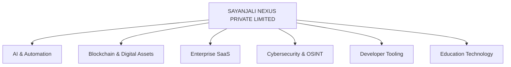

# SYED ALI HASAN MOOSAVI

### Founder · CTO · Managing Director · SAYANJALI NEXUS PRIVATE LIMITED

  
    <a href="#highlights">Highlights</a> ·
    <a href="#about">About</a> ·
    <a href="#what-i-build">What I Build</a> ·
    <a href="#ecosystem">Ecosystem</a> ·
    <a href="#featured-projects">Featured Projects</a> ·
    <a href="#project-explorer">Project Explorer</a> ·
    <a href="#contact">Contact</a>
  

---

<h2 id="highlights">Highlights</h2>

- 🏢 Founder of **SAYANJALI NEXUS PRIVATE LIMITED**
- 📦 Public software projects across AI, blockchain, software engineering and developer tooling
- 🤖 Applied AI systems and local-inference projects
- 💼 SaaS and workflow automation for CRM, recruitment and trade operations
- ⛓️ Blockchain infrastructure and developer tooling
- 🔐 Cybersecurity and OSINT tooling
- 🎓 Open-source education and engineering projects
- 🏥 Automation and compliance work for healthcare-adjacent projects

---

<h2 id="about">About</h2>

I'm the Founder · CTO · Managing Director of **SAYANJALI NEXUS PRIVATE LIMITED**, a technology company based in Hyderabad, India. I design and build software across artificial intelligence, blockchain infrastructure, enterprise automation, cybersecurity, and developer tooling.

The work is organized and presented publicly through **SYJ LABS**, the independent technology lab operated under SAYANJALI NEXUS PRIVATE LIMITED.

**Mission** — Build software that removes friction from real operations: compliance, communication, security, and data — without unnecessary complexity.

**Vision** — Build an ecosystem where AI, blockchain and automation infrastructure are open, auditable and useful to the businesses and developers that adopt them.

<h2 id="what-i-build">What I Build</h2>

**Core Domains**
- Artificial Intelligence & applied LLM systems
- Enterprise automation & workflow platforms
- Blockchain infrastructure & tokenomics
- Cybersecurity, OSINT & threat tooling
- Developer tools & CLI platforms
- Education technology

**Working Principles**
- Local-first AI over unnecessary hosted dependencies
- Complete, documented deliverables rather than partial snippets
- Resource-conscious engineering across supported platforms
- Verification through tests and end-to-end checks where documented
- Honest scope — no overstated claims

<h2 id="ecosystem">Company & Product Ecosystem</h2>

**SAYANJALI NEXUS PRIVATE LIMITED** — a registered Indian technology company operating across AI product development, blockchain infrastructure, cybersecurity/OSINT, enterprise SaaS, developer tooling, and education technology under the SAYANJALI / SYJ brand ecosystem.

---

<h2 id="featured-projects">Featured Projects</h2>

### 🧠 SYJ AI

Applied AI and automation tooling across the SAYANJALI NEXUS ecosystem.

[Repository](https://github.com/SHalimoosavi/SYJ-AI) · [Website](https://shalimoosavi.github.io/SYJ-AI-Landing/)

### 🔗 SAYANJALI Blockchain

A from-scratch blockchain implementation covering consensus, wallet cryptography, transactions and networking. The repository documents its current limitations and development phase.

[Repository](https://github.com/SHalimoosavi/SAYANJALI-BLOCKCHAIN) · [SYJ LABS project page](https://shalimoosavi.github.io/SYJ-Labs/projects/sayanjali-blockchain/)

### 📊 NexusIntel AI

AI-assisted business intelligence and automation platform work under the SYJ ecosystem.

[Repository](https://github.com/SHalimoosavi/SYJ-NexusIntel-AI-web) · [SYJ LABS project page](https://shalimoosavi.github.io/SYJ-Labs/projects/syj-nexusintel-ai-web/)

### 📈 SYJ OpenTrade Logic

Deterministic HTS classification and trade-compliance engineering with an explainable decision path.

[Repository](https://github.com/SHalimoosavi/SYJ-OpenTrade-Logic) · [SYJ LABS project page](https://shalimoosavi.github.io/SYJ-Labs/projects/syj-opentrade-logic/)

### 🧠 SYJ-LLM

A C/C++ local LLM runtime built around llama.cpp and GGUF, with memory budgeting, a model registry and an optional localhost API.

[Repository](https://github.com/SHalimoosavi/SYJ-LLM) · [SYJ LABS project page](https://shalimoosavi.github.io/SYJ-Labs/projects/syj-llm/)

### 🎓 SYJ Scholar AI

An open-source study assistant for document summaries, notes, flashcards, quizzes and exam preparation using locally runnable AI.

[Repository](https://github.com/SHalimoosavi/SYJ-SCHOLAR-AI) · [SYJ LABS project page](https://shalimoosavi.github.io/SYJ-Labs/projects/syj-scholar-ai/)

---

<h2 id="project-explorer">Project Explorer</h2>

The complete public project catalogue is maintained on **SYJ LABS**, where projects are grouped by flagship, active, experimental and archive status.

**Primary showcase:** https://shalimoosavi.github.io/SYJ-Labs/

The catalogue is generated from the same repository curation data used by the SYJ LABS site, rather than maintaining a separate public project count here.

---

<h2 id="contact">Contact</h2>

For engineering, open-source or collaboration enquiries:

**shalimoosavi@gmail.com**

**SYJ LABS:** https://shalimoosavi.github.io/SYJ-Labs/

**Founder portfolio:** https://shalimoosavi.github.io/moosavi/

**GitHub:** https://github.com/SHalimoosavi
