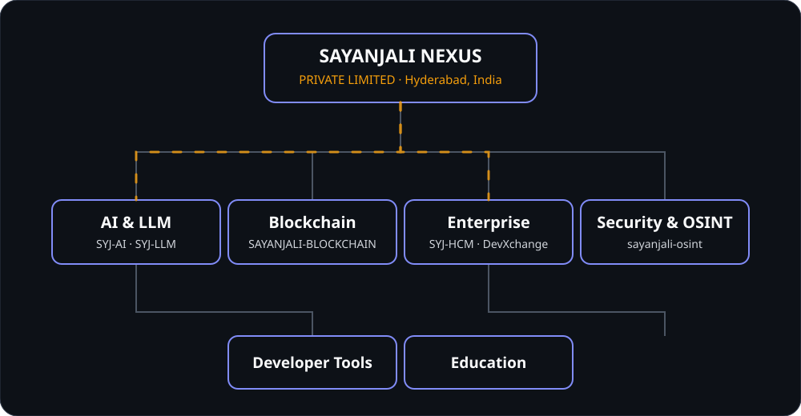

# Syed Ali Hasan Moosavi

Syed Ali Hasan Moosavi is the Founder and Managing Director of **SAYANJALI NEXUS PRIVATE LIMITED**, based in Hyderabad, India. He builds and maintains software across AI systems, blockchain infrastructure, enterprise automation, cybersecurity tooling and developer tools, with an emphasis on documented engineering, local inference and systems that can be inspected and operated by their users.

**Navigation:** [Highlights](#highlights) · [About](#about) · [What I Build](#what-i-build) · [Ecosystem](#ecosystem) · [Featured Projects](#featured-projects) · [Project Explorer](#project-explorer) · [Stack](#stack) · [GitHub Analytics](#github-analytics) · [FAQ](#faq) · [Open Source](#open-source-philosophy) · [Contact](#contact)

---

## Facts at a glance

- **Role:** Founder & Managing Director
- **Company:** SAYANJALI NEXUS PRIVATE LIMITED
- **Location:** Hyderabad, India
- **Focus areas:** AI systems, blockchain infrastructure, enterprise automation, cybersecurity tooling and developer tools
- **Primary languages across featured repositories:** Python, TypeScript, JavaScript and C++
- **Public repositories:** 84 public, non-fork, non-archived repositories (GitHub API search, 17 November 2026)
- **Portfolio:** [Engineering portfolio](https://shalimoosavi.github.io/moosavi/)
- **Company:** [SAYANJALI NEXUS PRIVATE LIMITED](https://shalimoosavi.github.io/SAYANJALI_NEXUS/)
- **Code:** [github.com/SHalimoosavi](https://github.com/SHalimoosavi)
- **Contact:** [cto@sayanjalinexus.com](mailto:cto@sayanjalinexus.com)

## Highlights

- Founder and Managing Director of **SAYANJALI NEXUS PRIVATE LIMITED**, Hyderabad, India.
- Maintains **84 public, non-fork, non-archived GitHub repositories**.
- Builds AI applications and local LLM infrastructure, including the C++17-based **SYJ-LLM** runtime.
- Develops blockchain protocol software and documents its current testnet and production-readiness boundaries.
- Builds enterprise workflow products for recruitment, human capital management and trade classification.
- Publishes cybersecurity, OSINT, education and developer-tool projects.

## About

I work across product architecture and implementation: understanding an operational problem, defining a practical system boundary, building the core, adding tests and documentation, and improving the result through review.

At **SAYANJALI NEXUS PRIVATE LIMITED**, the work spans AI products, blockchain infrastructure, enterprise software, cybersecurity and developer tooling. I prefer systems whose architecture and limitations are visible, and I try to distinguish shipped functionality from prototypes and roadmap work.

### Mission

Build useful software that reduces operational friction in communication, security, compliance, business workflows and access to technical knowledge — without adding unnecessary complexity or hiding important dependencies.

### Vision

Develop a connected product ecosystem under SAYANJALI NEXUS where AI, blockchain and automation systems can work together while remaining understandable, auditable and maintainable.

### Journey

My professional journey moved from dispatch and operations work into workflow automation, software engineering and AI systems development. I now lead product and engineering work through SAYANJALI NEXUS PRIVATE LIMITED, while continuing to publish independent projects and technical work in the open.

## What I Build

### Core domains

- **AI systems:** applied LLM workflows, autonomous software-engineering tools and local inference.
- **LLM infrastructure:** native runtimes, GGUF model handling, memory-aware execution and local APIs.
- **Blockchain infrastructure:** protocol engineering, consensus research, wallets, transactions and testnet tooling.
- **Enterprise automation:** recruitment, human capital management, CRM and trade-compliance workflows.
- **Cybersecurity and OSINT:** reconnaissance, security research and intelligence tooling.
- **Developer tools:** command-line utilities, build tooling and software workflow platforms.
- **Education technology:** open learning resources and practical engineering curricula.

### Working principles

- Read the existing system before changing it.
- Prefer understandable architectures and explicit dependencies.
- Keep documentation aligned with the actual implementation.
- Test behavior, not just whether a project starts.
- Separate verified capabilities from prototypes, experiments and roadmap items.
- Avoid unnecessary vendor lock-in; use local execution where it is a practical fit.

## Ecosystem

**SAYANJALI NEXUS PRIVATE LIMITED** is the company behind a portfolio of software projects spanning AI, blockchain, enterprise applications, cybersecurity, developer tools and education technology.

The diagram is a high-level grouping of the engineering portfolio. The text list below remains the reference if images are unavailable.

- **AI and LLM:** SYJ-AI, SYJ-LLM, SYJ-SCHOLAR-AI and related applied AI work.
- **Blockchain:** SAYANJALI-BLOCKCHAIN and the SYJ ecosystem.
- **Enterprise software:** SYJ-HCM, SYJ-TalentFlow-Cli and SYJ-OpenTrade-Logic.
- **Security and intelligence:** SAYANJALI OSINT and security-focused utilities.
- **Developer tools:** SYJ-OS, SYJ-LaunchPad and supporting engineering tools.
- **Education:** SYJ-WebForge-Academy and SYJ-SCHOLAR-AI.

## Featured Projects

The selection below is based on repository evidence: a README, tests or a test directory, CI workflow where present, recent push activity, community signals, a non-empty repository description, license file presence and a verified live homepage where available. Project status is stated conservatively.

| Project | What it does | Stack | Current status and links |
|---|---|---|---|
| **[SYJ-AI](https://github.com/SHalimoosavi/SYJ-AI)** | An open-source, local-first autonomous software-engineering agent that organizes work across planning, research, design, coding, review and verification using local models. | Python, Ollama | Active development · [Project site](https://shalimoosavi.github.io/SYJ-AI-Landing/) |
| **[SAYANJALI-BLOCKCHAIN](https://github.com/SHalimoosavi/SAYANJALI-BLOCKCHAIN)** | An independently engineered Layer-1 protocol project covering consensus, transactions, wallets, persistent storage and peer-to-peer networking. | Python, Go | Phase 10.1 documentation and validation work; **not production-ready or mainnet-ready** · [Project site](https://shalimoosavi.github.io/syj-blockchain-web/) |
| **[SYJ-TalentFlow-Cli](https://github.com/SHalimoosavi/SYJ-TalentFlow-Cli)** | An open-source recruitment automation toolkit for parsing resumes, matching candidates to job descriptions, generating interview questions and preparing recruiter communications. | JavaScript, Node.js | Active development · [Project site](https://shalimoosavi.github.io/SYJ-TalentFlow-Cli-Web/) |
| **[SYJ-OpenTrade-Logic](https://github.com/SHalimoosavi/SYJ-OpenTrade-Logic)** | An open-source deterministic HTS classification engine that applies explainable General Rules of Interpretation rather than relying on opaque classification output. | Python | Active development · [Repository](https://github.com/SHalimoosavi/SYJ-OpenTrade-Logic) |
| **[SYJ-LLM](https://github.com/SHalimoosavi/SYJ-LLM)** | A C++17 offline-first LLM runtime built around llama.cpp and GGUF, with a local model registry, memory-aware execution, CLI workflows and an optional localhost API foundation. | C++17, CMake, llama.cpp | Phase 5 — Fine-Tuning Pipeline; later Studio, remote access and platform packaging remain unimplemented · [Repository](https://github.com/SHalimoosavi/SYJ-LLM) |
| **[SYJ-Video-Forge](https://github.com/SHalimoosavi/SYJ-Video-Forge)** | A browser interface, local backend and file-bundle GPU worker for open video models, using a user-controlled inference environment. | Python, JavaScript, FFmpeg | v0.3.0 pre-release; real inference is implemented but remains unverified on real GPU hardware · [Repository](https://github.com/SHalimoosavi/SYJ-Video-Forge) |
| **[SYJ-HCM](https://github.com/SHalimoosavi/SYJ-HCM)** | A multi-tenant human capital management and applicant tracking application covering employee management, recruitment, careers, documents, interviews and offer workflows. | TypeScript, Next.js, Drizzle ORM, SQLite | v0.13.0-alpha · Phase 2.4 documented in the repository · [Repository](https://github.com/SHalimoosavi/SYJ-HCM) |
| **[SYJ-OS](https://github.com/SHalimoosavi/SYJ-OS)** | A browser-based virtual-device simulator prototype for exploring device interface and system concepts; it is not a standalone operating system or hardware emulator. | TypeScript, Vite, React | v0.1.0 prototype · [Repository](https://github.com/SHalimoosavi/SYJ-OS) |

## Project Explorer

Browse the full [public repository catalog](https://github.com/SHalimoosavi?tab=repositories). The categories below link to representative repositories rather than relying on broad search queries that may return inconsistent results.

<strong>AI and Machine Learning</strong>

- [SYJ-AI](https://github.com/SHalimoosavi/SYJ-AI) — autonomous software-engineering agent.
- [SYJ-LLM](https://github.com/SHalimoosavi/SYJ-LLM) — native local LLM runtime.
- [SYJ-SCHOLAR-AI](https://github.com/SHalimoosavi/SYJ-SCHOLAR-AI) — open-source study companion.
- [syj-mail-intelligence-ai](https://github.com/SHalimoosavi/syj-mail-intelligence-ai) — mail intelligence project.
- [SYJ-AI-Arena](https://github.com/SHalimoosavi/SYJ-AI-Arena) — model experimentation project.
- [SYJ-CanvasForge](https://github.com/SHalimoosavi/SYJ-CanvasForge) — AI-assisted visual content and document tooling.

<strong>Blockchain and Web3</strong>

- [SAYANJALI-BLOCKCHAIN](https://github.com/SHalimoosavi/SAYANJALI-BLOCKCHAIN) — Layer-1 protocol engineering.
- [SYJ-TOKEN](https://github.com/SHalimoosavi/SYJ-TOKEN) — token ecosystem repository.
- [syj-blockchain-web](https://github.com/SHalimoosavi/syj-blockchain-web) — blockchain project website.

<strong>Healthcare and Human Capital Software</strong>

- [SYJ-HCM](https://github.com/SHalimoosavi/SYJ-HCM) — HCM and applicant tracking.
- [Sayanjali-Nexus-CRM](https://github.com/SHalimoosavi/Sayanjali-Nexus-CRM) — CRM application.
- [SYJ-GST-Reconciliation](https://github.com/SHalimoosavi/SYJ-GST-Reconciliation) — GST reconciliation tooling.

<strong>Enterprise Automation and Business Operations</strong>

- [SYJ-TalentFlow-Cli](https://github.com/SHalimoosavi/SYJ-TalentFlow-Cli) — recruitment automation.
- [SYJ-OpenTrade-Logic](https://github.com/SHalimoosavi/SYJ-OpenTrade-Logic) — deterministic trade classification.
- [SYJ-QuickStock-Sync](https://github.com/SHalimoosavi/SYJ-QuickStock-Sync) — inventory synchronization.
- [SYJ-LeadForge](https://github.com/SHalimoosavi/SYJ-LeadForge) — lead workflow tooling.
- [SYJ-Property-Sync](https://github.com/SHalimoosavi/SYJ-Property-Sync) — property workflow project.

<strong>Education Platforms</strong>

- [SYJ-SCHOLAR-AI](https://github.com/SHalimoosavi/SYJ-SCHOLAR-AI) — study companion.
- [SYJ-WebForge-Academy](https://github.com/SHalimoosavi/SYJ-WebForge-Academy) — web development training platform.
- [SYJ-Educate](https://github.com/SHalimoosavi/SYJ-Educate) — open engineering curriculum · [Project site](https://shalimoosavi.github.io/SYJ-EDU/index.html).

<strong>Developer Tools and Infrastructure</strong>

- [SYJ-LaunchPad](https://github.com/SHalimoosavi/SYJ-LaunchPad) — launchpad infrastructure.
- [SYJ-DEPLOY](https://github.com/SHalimoosavi/SYJ-DEPLOY) — self-hosted deployment platform.
- [SYJ-OS](https://github.com/SHalimoosavi/SYJ-OS) — virtual-device simulator prototype.
- [SYJ-CanvasForge](https://github.com/SHalimoosavi/SYJ-CanvasForge) — visual content tooling · [Project site](https://shalimoosavi.github.io/SYJ-CanvasForge/).
- [SYJ-Gridsync-Os](https://github.com/SHalimoosavi/SYJ-Gridsync-Os) — grid synchronization middleware.
- [DevXchange](https://github.com/SHalimoosavi/DevXchange) — software marketplace project.

<strong>Cybersecurity and OSINT</strong>

- [sayanjali-osint](https://github.com/SHalimoosavi/sayanjali-osint) — OSINT and reconnaissance tooling.
- [SYJ-Aegis](https://github.com/SHalimoosavi/SYJ-Aegis) — security-focused project.
- [SYJ-Nexus-Sentinel-Audit](https://github.com/SHalimoosavi/SYJ-Nexus-Sentinel-Audit) — security audit tooling.
- [SYJ-InstaRecon](https://github.com/SHalimoosavi/SYJ-InstaRecon) — reconnaissance project.

<strong>Experimental Projects</strong>

Prototypes and research projects are part of the wider repository catalog. Their individual READMEs define what is implemented and what remains experimental.

[Browse all public repositories](https://github.com/SHalimoosavi?tab=repositories).

## Stack

The technologies below are represented in the featured repositories and their documentation.

- **Languages:** Python, TypeScript, JavaScript, C++17.
- **Frameworks and runtimes:** FastAPI, Next.js, React, Node.js.
- **AI and model tooling:** Ollama, llama.cpp, GGUF.
- **Data and build tools:** SQLite, PostgreSQL, Drizzle ORM, CMake.
- **Engineering and delivery:** GitHub Actions, Docker, automated tests.

## GitHub Analytics

GitHub's native profile contribution graph and repository pages are the reference for current activity. I have not embedded third-party streak or activity widgets here because their availability and rendering could not be established reliably during this update.

- [View GitHub contribution activity](https://github.com/SHalimoosavi)
- [Browse repositories and current repository metrics](https://github.com/SHalimoosavi?tab=repositories)

## FAQ

### Who is Syed Ali Hasan Moosavi?

Syed Ali Hasan Moosavi is the Founder and Managing Director of SAYANJALI NEXUS PRIVATE LIMITED. His public engineering work covers AI systems, blockchain infrastructure, enterprise software, cybersecurity tooling and developer tools.

### What is SAYANJALI NEXUS PRIVATE LIMITED?

SAYANJALI NEXUS PRIVATE LIMITED is a technology company based in Hyderabad, India. Its public software portfolio includes AI, blockchain, enterprise applications, security tooling, developer infrastructure and education projects.

### What open-source projects does Syed Ali Hasan Moosavi maintain?

The public portfolio includes SYJ-AI, SAYANJALI-BLOCKCHAIN, SYJ-TalentFlow-Cli, SYJ-OpenTrade-Logic, SYJ-LLM, SYJ-Video-Forge, SYJ-HCM and SYJ-OS, among other repositories. The [GitHub repository catalog](https://github.com/SHalimoosavi?tab=repositories) is the current source for the complete list.

### What is SYJ-LLM?

SYJ-LLM is a C++17 offline-first LLM runtime built around llama.cpp and GGUF models. Its documented components include a local model registry, memory-aware execution, CLI workflows, an optional localhost API foundation and a fine-tuning pipeline.

### What technologies does he work with?

The featured repositories use Python, TypeScript, JavaScript and C++17, alongside FastAPI, Next.js, React, Node.js, SQLite, PostgreSQL, CMake, Ollama and llama.cpp.

### Where is Syed Ali Hasan Moosavi based?

Syed Ali Hasan Moosavi is based in Hyderabad, Telangana, India, and leads SAYANJALI NEXUS PRIVATE LIMITED from Hyderabad.

### How can I contact him for engineering work?

For company and engineering enquiries, email [cto@sayanjalinexus.com](mailto:cto@sayanjalinexus.com). For direct contact, use [shalimoosavi@gmail.com](mailto:shalimoosavi@gmail.com).

### Is SAYANJALI BLOCKCHAIN production-ready?

No. The repository's current documentation explicitly states that SAYANJALI BLOCKCHAIN is not production-ready and not mainnet-ready. Its current development and validation work should be understood as protocol engineering, not a live production network.

## Open Source Philosophy

I publish software so that other developers can inspect the implementation, understand its dependencies and decide whether it fits their work. Documentation should describe the code that exists, tests should exercise real behavior, and project status should distinguish implemented features from future plans.

Where local inference or self-hosting is practical, I prefer keeping control of the runtime and data with the operator. Open source is most useful when the project is understandable, reproducible and honest about its limits.

## Contact

| Channel | Purpose |
|---|---|
| [cto@sayanjalinexus.com](mailto:cto@sayanjalinexus.com) | CTO Office — company, engineering and business enquiries |
| [shalimoosavi@gmail.com](mailto:shalimoosavi@gmail.com) | Personal contact |
| [Engineering portfolio](https://shalimoosavi.github.io/moosavi/) | Portfolio and project context |
| [SAYANJALI NEXUS PRIVATE LIMITED](https://shalimoosavi.github.io/SAYANJALI_NEXUS/) | Company website |
| [GitHub profile](https://github.com/SHalimoosavi) | Public repositories and development activity |

**SAYANJALI NEXUS PRIVATE LIMITED · Hyderabad, India**

  Building and documenting practical software through SAYANJALI NEXUS PRIVATE LIMITED.

